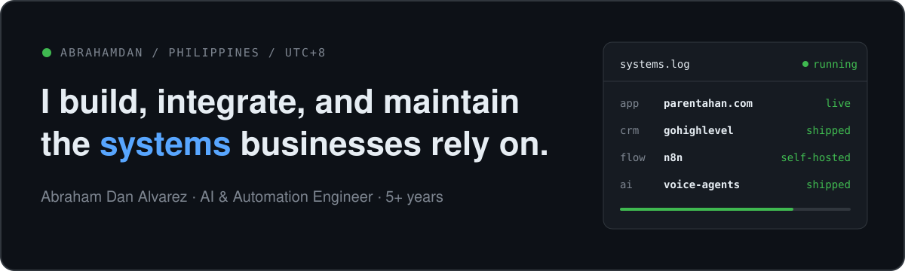

Hi, I'm Dan. I'm an AI & Automation Engineer based in the Philippines. For 5+ years I've built websites, set up CRMs, connected tools through APIs and webhooks, run self-hosted services, and fixed computers when they wouldn't boot. I like owning a problem from the first question to the handover.

### What I've built

- **[Parentahan.com](https://parentahan.com)** - a rental marketplace for the Philippines where you find rooms, houses and condos by location. I founded it and built it. Live since April 2026, free for renters and listers.
- **[Property Lead Connect](https://propertyleadconnect.co.uk)** - a UK property lead-sharing marketplace where contact details are only revealed when both sides agree. React, Vite and Supabase. Co-founder.
- **[Elevate Property System](https://elevatepropertysystem.co.uk)** - lead capture, a 14-stage GoHighLevel pipeline, dashboards and follow-up automation for UK property professionals. Technical implementer.
- **AI voice agents and lead scoring** - inbound and outbound AI calling (VAPI, n8n, GoHighLevel), lead scoring, postcode data enrichment, and an AI sales coach for a UK property company's sales team.

### What I work with

**Automation & CRM** · n8n, Zapier, Make, GoHighLevel, Google Apps Script, REST APIs, webhooks 
**AI** · OpenAI, Anthropic Claude, OpenRouter, Gemini, VAPI 
**Web** · React, Vite, TypeScript, Tailwind CSS, WordPress, Supabase, Stripe 
**Infrastructure** · Ubuntu VPS, Docker, Virtualmin, Cloudflare, DNS and SSL, Git 
**IT support** · hardware diagnosis and upgrades, Windows installs, remote support over AnyDesk

Currently learning: deeper Python and JavaScript, Next.js, Node.js and AI agents.

### Find me

[Portfolio](https://abrahamdan.com) · [LinkedIn](https://www.linkedin.com/in/abrhmalvarez/) · [contact@abrahamdan.com](mailto:contact@abrahamdan.com)
